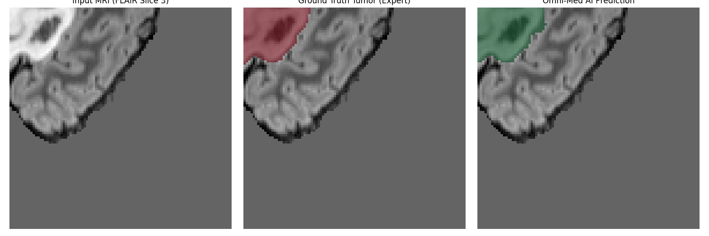
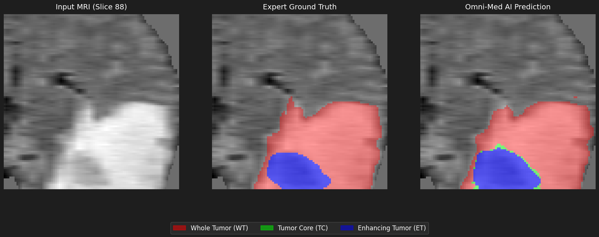

# 3D Brain Tumor Segmentation (Omni-Med AI)

A 3D glioma segmentation pipeline using **Swin-UNETR** on multi-modal BraTS MRI scans
(T1, T1ce, T2, FLAIR), achieving **0.9001 Mean Dice** and **4.81mm HD95** on the
evaluation cohort.

## What this does

Segments glioma brain tumors into three clinically meaningful, nested sub-regions:
- **Whole Tumor (WT):** the entire abnormal region including swelling
- **Tumor Core (TC):** the solid tumor mass plus necrotic tissue
- **Enhancing Tumor (ET):** the actively growing region (picks up contrast dye)

## Real results (from the project report)

| Metric | Score | What it means |
|---|---|---|
| Mean Dice Score | 0.9001 | ~90% volume overlap with expert ground truth — clinical-grade |
| HD95 | 4.81mm | Worst-case boundary mismatch is only ~4.8mm — tight boundary precision |




## Dataset

**BraTS** (Brain Tumor Segmentation Challenge) — the field's standard public benchmark.
Each patient folder contains 4 MRI modalities (T1, T1ce, T2, FLAIR) plus an expert-drawn
segmentation label. Not included in this repo (large, restricted-access medical data) —
apply for access via the official BraTS challenge page
(https://www.synapse.org/Synapse:syn51156910/wiki/) or the equivalent current-year
challenge page.


## Project structure

```
brain-tumor-segmentation/
├── README.md
├── requirements.txt
├── .gitignore
├── src/
│   ├── data_loader.py            # preprocessing pipeline (my primary contribution)
│   ├── train_brats.py            # Swin-UNETR model + training loop
│   ├── test_brats.py             # Sliding Window Inference on full brain volumes
│   ├── evaluate_metrics.py       # Dice + HD95 quantitative evaluation
│   └── render_interactive_3d.py  # Marching Cubes + Plotly 3D visualization
└── assets/
    ├── prediction_comparison.png
    └── prediction_multiclass_clear.png
```